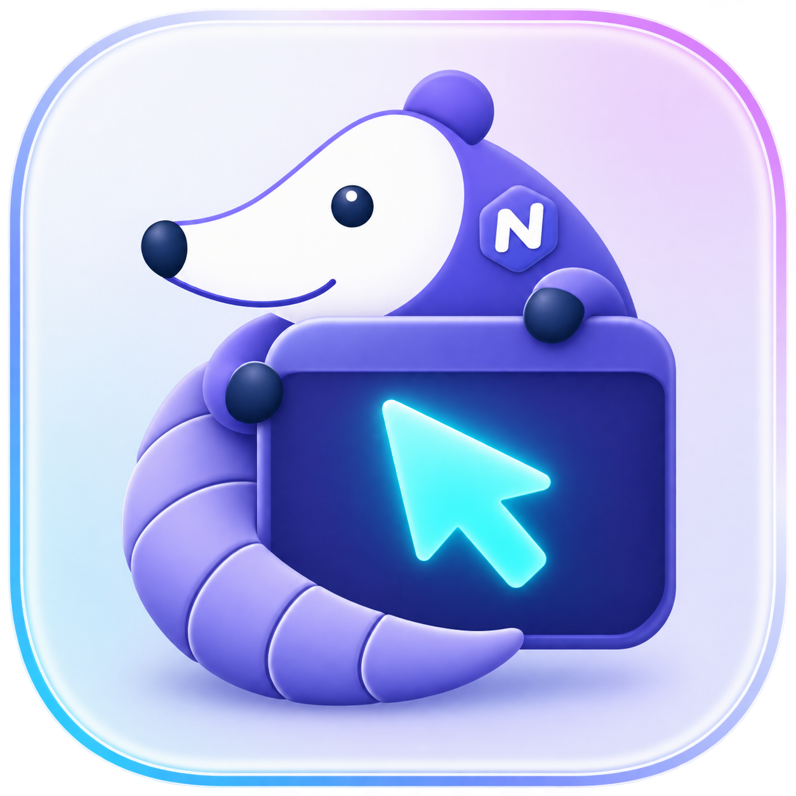
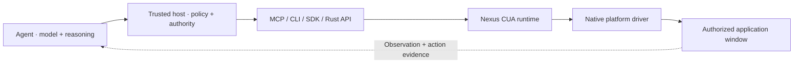

<p align="center">
  
</p>

<div align="center">

# Nexus CUA

**Native desktop control for AI agents.**

Observe windows. Act within granted permissions. Verify what changed.

[](https://github.com/nexus-research-lab/nexus-cua/actions/workflows/ci.yml)
[](LICENSE)
[](https://github.com/nexus-research-lab/nexus-cua/releases)
[](https://github.com/nexus-research-lab/nexus-cua/releases/tag/v0.2.0)

[Quick start](#quick-start) · [Integrations](#integrations) · [Documentation](#documentation) · [Releases](https://github.com/nexus-research-lab/nexus-cua/releases)

**English** · [简体中文](README.zh-CN.md)

</div>

Nexus CUA gives agent applications a common interface to native desktop windows:
window screenshots, accessibility information, mouse and keyboard input, and
post-action verification. It is written in Rust, with MCP and CLI bindings and
Go, Python, and TypeScript SDKs.

Built for the [Nexus](https://github.com/nexus-research-lab/nexus) ecosystem,
**Nexus Computer Use Runtime** can also be integrated into independent hosts.
Your agent supplies the model and reasoning loop; its host grants authority;
Nexus CUA checks and executes desktop operations. No model provider is built in.

> **Early release.** The current release is
> [v0.2.0 for macOS Apple Silicon/Intel and Windows x64](https://github.com/nexus-research-lab/nexus-cua/releases/tag/v0.2.0).
> See [platform status](#platform-status) for open validation work
> before choosing a deployment target.

## Why Nexus CUA?

- **See the exact window.** Combine screenshots with native accessibility
  elements, including selected, checked, and expanded states. Use normalized
  coordinates or a zoomed view for visual targets.
- **Use native controls.** Invoke buttons, set text and numeric values, select
  items, and expand controls. Mouse, keyboard, scroll, drag, and bounded holds
  cover interactions without useful accessibility actions.
- **Keep authority explicit.** The host selects applications, action categories,
  foreground access, and a finite session lifetime. Every window action is
  guarded by a fresh observation of that target.
- **Handle uncertain outcomes.** Stable mutation IDs and read-only reconciliation
  let hosts check a timed-out request without blindly repeating an operation.
  Results distinguish native confirmation from dispatch-only evidence.
- **Choose your integration.** Use MCP tools, the CLI binding, a typed SDK over
  private local IPC, or the embedded Rust runtime. Capabilities are negotiated
  through the versioned `nexus.cua.v1` protocol.
- **Bound resource use.** Accessibility traversal, image retention, input
  duration, queues, and deadlines have explicit limits. Screenshots and
  accessibility content are transient and must not be logged or persisted by
  integrations.

## Download v0.2.0

| Platform | Runtime archive |
| --- | --- |
| macOS · Apple Silicon | [nexuscua-0.2.0-macos-arm64.tar.gz](https://github.com/nexus-research-lab/nexus-cua/releases/download/v0.2.0/nexuscua-0.2.0-macos-arm64.tar.gz) |
| macOS · Intel | [nexuscua-0.2.0-macos-x86_64.tar.gz](https://github.com/nexus-research-lab/nexus-cua/releases/download/v0.2.0/nexuscua-0.2.0-macos-x86_64.tar.gz) |
| Windows · x64 | [nexuscua-0.2.0-windows-x86_64.zip](https://github.com/nexus-research-lab/nexus-cua/releases/download/v0.2.0/nexuscua-0.2.0-windows-x86_64.zip) |

Verify the archive against `SHA256SUMS`, then extract it. Manifests, SBOMs,
and third-party notices are included on the [release page](https://github.com/nexus-research-lab/nexus-cua/releases/tag/v0.2.0).

On Windows, run `Get-FileHash .\nexuscua-0.2.0-windows-x86_64.zip -Algorithm SHA256`
in PowerShell to compute the checksum. From the extracted directory, run
`.\nexuscua.exe doctor` to inspect runtime capabilities and permission state.
Continue with the [MCP integration guide](docs/codex-mcp.md) or the
[Python source walkthrough](docs/quickstart-python.md).

## Quick start

The source workflow below builds the runtime and runs a controlled local example
on **macOS Apple Silicon**. It needs Rust 1.88+, Python 3.10–3.13, and Xcode
Command Line Tools for the Swift test app. No model API key is required.

### 1. Build and check permissions

```bash
git clone https://github.com/nexus-research-lab/nexus-cua.git
cd nexus-cua
cargo build --release --locked --package nexus-cua --bin nexuscua
./target/release/nexuscua doctor
```

Review the permissions reported by `doctor`. Native capture and semantic
control require Screen Recording and Accessibility permission for the runtime
identity. Foreground input also needs input permissions, including Input
Monitoring for takeover detection. Diagnostics do not grant OS permissions.

Prebuilt release archives, checksums, SBOMs, and notices are available on the
[release page](https://github.com/nexus-research-lab/nexus-cua/releases).

### 2. Open the test app and start the sidecar

```bash
make native-fixture-macos
open "target/native-fixtures/macos/Nexus CUA Native Fixture.app"
./target/release/nexuscua serve --dev-root .cache/quickstart
```

Keep this terminal running. The **Native Fixture** is a deterministic test app
with buttons, text fields, and pointer targets. It is a development tool;
ordinary agent integrations control the applications their host authorizes.

### 3. Run the Python example

In a second terminal at the repository root:

```bash
python3 -m venv .cache/quickstart-venv
source .cache/quickstart-venv/bin/activate
python -m pip install ./sdk/python
python sdk/python/examples/quickstart.py \
  --endpoint "$PWD/.cache/quickstart/service.sock" \
  --token-file "$PWD/.cache/quickstart/token" \
  --application "Nexus CUA Native Fixture"
```

The example discovers the fixture, opens a 60-second session authorizing only
`invoke_element`, observes its window, invokes **Increment Counter**, reads fresh
state, and closes the session in a `finally` block. It prints an action summary.
Stop the sidecar with **Ctrl-C** when finished, then close the test app.

This is **trusted-host code**: the sidecar token stays with the host and must
never be passed to an agent or included in a prompt. See the
[Python walkthrough](docs/quickstart-python.md) for the complete workflow and
Windows source-development instructions.

## Integrations

| Your use case | Interface | Start here |
| --- | --- | --- |
| Connect an MCP-capable agent host | MCP over local stdio or authenticated Streamable HTTP | [MCP integration guide](docs/codex-mcp.md) |
| Connect a shell-capable agent through a trusted host | `nexuscua` CLI + CLI-bound Skill | [CLI Skill](skills/cli/SKILL.md) |
| Build a Python host | Typed Python SDK | [Python SDK](sdk/python/README.md) |
| Build a Node.js host | Typed TypeScript/JavaScript SDK | [TypeScript SDK](sdk/typescript/README.md) |
| Build a Go host | Typed Go SDK | [Go SDK](sdk/go/README.md) |
| Embed execution in Rust | Runtime and platform crates | [Architecture](docs/architecture.md) |

MCP and CLI expose the same execution contract. Both need host-issued authority;
installing a binary alone does not grant desktop access. The registered MCP
alias is **`nexuscua`**, with tool names such as `observe_window`,
`perform_action`, and `reconcile_mutation`.

The automatic MCP configuration assistant currently targets **Codex over
stdio**. Other hosts need integration work. CLI service auto-start, seamless
grant renewal, and registered HTTP host installation remain in development.
The [generated MCP Skill](skills/mcp/SKILL.md) describes the agent-facing workflow;
[sidecar supervision](docs/sidecar-supervision.md) covers host lifecycle handling.

## How it works



The interaction cycle is **observe → act → verify**:

1. The host grants a finite session for specific applications and actions.
2. The agent observes one exact window and receives opaque window, observation,
   and element references.
3. An action presents that fresh observation and a stable request ID. The
   runtime checks authority and target state before dispatch.
4. A new observation or deterministic verification establishes the result.
   If the outcome is uncertain, reconcile the original request ID before
   deciding what to do next.

Physical-display overview and clipboard access require separate authority.
A display observation never authorizes an action. Browser DOM, tabs, CDP,
network inspection, OCR, and model inference sit outside the desktop contract.
See the [protocol](docs/specs/protocol-v1.md) and
[runtime contract](docs/specs/runtime-contract-v1.md) for details.

## Platform status

| Platform | Current status |
| --- | --- |
| macOS · Apple Silicon | Released; native interaction and bounded integration scenarios exercised locally |
| macOS · Intel | Released; build, source tests, signing, notarization and diagnostic smoke passed; interactive native acceptance pending |
| Windows · x64 | Released; native core, cancellation, recovery, fault and resource diagnostics exercised locally |
| Linux | No native desktop driver |

Each release records how its runtimes were signed in its manifests and release
notes. Clean-machine installation and full release acceptance remain open. Local
fixture checks do not establish support for every application or prove general
agent task success. Current evidence and remaining work are recorded in
[platform validation](docs/platform-validation.md), the [release process](docs/releasing.md), the [changelog](CHANGELOG.md),
and the [product roadmap / PRD](docs/PRD.zh-CN.md).

## Documentation

| Topic | Reference |
| --- | --- |
| Product scope, priorities, and roadmap | [完整产品与开发 PRD（中文）](docs/PRD.zh-CN.md) |
| Architecture and ownership boundaries | [Architecture](docs/architecture.md) |
| Public protocol and execution semantics | [Protocol v1](docs/specs/protocol-v1.md) · [Runtime contract](docs/specs/runtime-contract-v1.md) |
| Host policy and sidecar lifecycle | [Runtime policy](docs/runtime-policy.md) · [Supervision](docs/sidecar-supervision.md) |
| Remote desktops and isolation boundaries | [Execution environments](docs/specs/execution-environments.md) |
| Compatibility and packaging | [Compatibility](docs/compatibility.md) · [Packaging](packaging/README.md) |
| Native testing and platform evidence | [Fixture guide](fixtures/native/README.md) · [Validation](docs/platform-validation.md) |

## Contributing

Bug reports, documentation improvements, host integrations, and native platform
validation are welcome. [Open an issue](https://github.com/nexus-research-lab/nexus-cua/issues)
with the runtime version, OS, expected behavior, and a minimal reproduction.
Keep tokens, screenshots, accessibility trees, and private application content
out of issue reports.

Read [AGENTS.md](AGENTS.md) for repository boundaries. Keep changes focused and
run the quality gate before submitting a pull request:

```bash
make check PYTHON=python3.11
```

The complete check also needs Go, Node.js/npm, and Python. It covers Rust
formatting and Clippy, tests, protocol schemas, generated Skills, documentation,
release helpers, the native harness, and SDK checks. Use `make help` for
individual targets. Windows contributors can run
[`scripts/check-windows.ps1`](scripts/check-windows.ps1) without GNU Make.

Report vulnerabilities through the [security policy](SECURITY.md).

## License

[MIT](LICENSE) · [Third-party notices](THIRD_PARTY_NOTICES.md)

A [Nexus Research Lab](https://github.com/nexus-research-lab) project.
