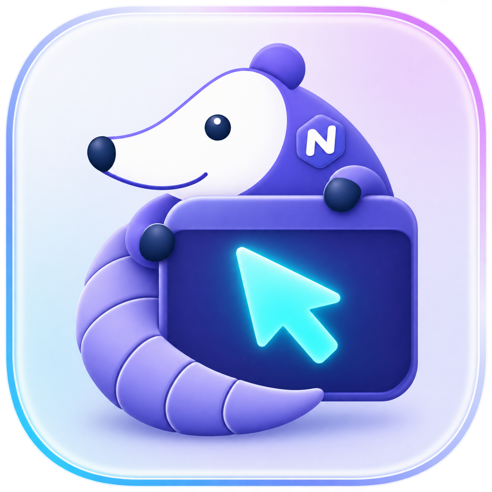
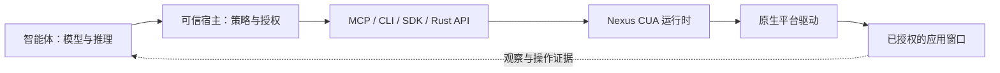

<p align="center">
  
</p>

<div align="center">

# Nexus CUA

**让 AI 智能体操作原生桌面应用。**

观察窗口，在授权范围内执行操作，再验证结果。

[](https://github.com/nexus-research-lab/nexus-cua/actions/workflows/ci.yml)
[](LICENSE)
[](https://github.com/nexus-research-lab/nexus-cua/releases)
[](https://github.com/nexus-research-lab/nexus-cua/releases/tag/v0.2.0)

[快速开始](#快速开始) · [接入方式](#接入方式) · [文档](#文档) · [发布版本](https://github.com/nexus-research-lab/nexus-cua/releases)

[English](README.md) · **简体中文**

</div>

Nexus CUA 为智能体应用提供统一的原生桌面接口：窗口截图、辅助功能信息、鼠标键盘输入，以及操作后的验证。核心使用 Rust 编写，提供 MCP、CLI 和 Go、Python、TypeScript SDK。

**Nexus Computer Use Runtime** 为 [Nexus](https://github.com/nexus-research-lab/nexus) 生态构建，也支持独立宿主接入。智能体负责模型与推理循环，宿主负责授权，Nexus CUA 负责检查并执行桌面操作。运行时本身不内置模型服务。

> **早期正式版。** 当前已发布 macOS Apple Silicon / Intel 与 Windows x64 的 v0.2.0，尚未完成的平台验收见下文。[下载](https://github.com/nexus-research-lab/nexus-cua/releases/tag/v0.2.0)

## 为什么选择 Nexus CUA？

- **看清目标窗口。** 结合截图和原生辅助功能元素，读取选中、勾选、展开等状态；视觉定位可使用归一化坐标或局部放大。
- **操作原生控件。** 调用按钮、填写文本与数值、选择项目、展开控件；缺少辅助功能动作时，可使用鼠标、键盘、滚动、拖拽和限时按住。
- **明确授权范围。** 宿主指定应用、动作类别、前台访问权限和有限的会话期限。窗口动作必须携带针对该目标的新鲜观察。
- **处理不确定结果。** 稳定的变更请求 ID 和只读结果核对，让宿主在请求超时后先查明状态，避免盲目重试。返回结果区分原生确认与仅已派发的证据。
- **自由选择接入方式。** 可使用 MCP、CLI、私有本地 IPC 上的类型化 SDK，或嵌入 Rust 运行时。版本化的 `nexus.cua.v1` 协议支持能力协商。
- **约束资源占用。** 辅助功能遍历、图像保留、输入持续时间、队列和截止时间都有明确上限。截图与辅助功能内容仅作瞬时处理，接入方不得记录或持久化。

## 下载 v0.2.0

| 平台 | Runtime 安装包 |
| --- | --- |
| macOS · Apple Silicon | [nexuscua-0.2.0-macos-arm64.tar.gz](https://github.com/nexus-research-lab/nexus-cua/releases/download/v0.2.0/nexuscua-0.2.0-macos-arm64.tar.gz) |
| macOS · Intel | [nexuscua-0.2.0-macos-x86_64.tar.gz](https://github.com/nexus-research-lab/nexus-cua/releases/download/v0.2.0/nexuscua-0.2.0-macos-x86_64.tar.gz) |
| Windows · x64 | [nexuscua-0.2.0-windows-x86_64.zip](https://github.com/nexus-research-lab/nexus-cua/releases/download/v0.2.0/nexuscua-0.2.0-windows-x86_64.zip) |

下载后对照 `SHA256SUMS` 校验，再解压。发布页同时提供 manifest、SBOM 和第三方声明。[发布页面](https://github.com/nexus-research-lab/nexus-cua/releases/tag/v0.2.0)

Windows 可在 PowerShell 中运行 `Get-FileHash .\nexuscua-0.2.0-windows-x86_64.zip -Algorithm SHA256`
计算校验值。在解压目录运行 `.\nexuscua.exe doctor`，检查运行时能力与权限状态。
随后按 MCP 接入指南配置宿主，或使用 Python 源码流程运行受控示例。[MCP 接入指南](docs/codex-mcp.md) · [Python 快速开始](docs/quickstart-python.md)

## 快速开始

以下源码流程在 **macOS Apple Silicon** 上构建运行时，并运行一个受控的本地示例。需要 Rust 1.88+、Python 3.10–3.13，以及用于构建 Swift 测试应用的 Xcode Command Line Tools。无需模型 API Key。

### 1. 构建并检查权限

```bash
git clone https://github.com/nexus-research-lab/nexus-cua.git
cd nexus-cua
cargo build --release --locked --package nexus-cua --bin nexuscua
./target/release/nexuscua doctor
```

检查 `doctor` 报告的权限。原生截图与语义控制需要向运行时身份授予屏幕录制和辅助功能权限；前台输入还需要相应输入权限，包括用于检测用户接管的输入监控权限。诊断命令不会自动授予系统权限。

预编译发布包、校验和、SBOM 和第三方声明见[发布页面](https://github.com/nexus-research-lab/nexus-cua/releases)。

### 2. 打开测试应用并启动 sidecar

```bash
make native-fixture-macos
open "target/native-fixtures/macos/Nexus CUA Native Fixture.app"
./target/release/nexuscua serve --dev-root .cache/quickstart
```

保持该终端运行。**Native Fixture** 是包含按钮、文本框和指针目标的确定性测试应用，用于开发验证；实际接入时，智能体操作的是宿主授权的应用。

### 3. 运行 Python 示例

在仓库根目录打开第二个终端：

```bash
python3 -m venv .cache/quickstart-venv
source .cache/quickstart-venv/bin/activate
python -m pip install ./sdk/python
python sdk/python/examples/quickstart.py \
  --endpoint "$PWD/.cache/quickstart/service.sock" \
  --token-file "$PWD/.cache/quickstart/token" \
  --application "Nexus CUA Native Fixture"
```

示例发现测试应用，创建一个仅授权 `invoke_element`、有效期为 60 秒的会话，观察窗口，调用 **Increment Counter**，读取新状态，并在 `finally` 中关闭会话。终端会输出动作摘要。完成后按 **Ctrl-C** 停止 sidecar，再关闭测试应用。

这段代码运行在**可信宿主**一侧：sidecar token 由宿主持有，不能交给智能体或写入提示词。完整流程及 Windows 源码开发说明见 [Python 快速开始](docs/quickstart-python.md)。

## 接入方式

| 使用场景 | 接口 | 入口 |
| --- | --- | --- |
| 接入支持 MCP 的智能体宿主 | 本地 stdio 或带认证的 Streamable HTTP | [MCP 接入指南](docs/codex-mcp.md) |
| 通过可信宿主接入可调用 Shell 的智能体 | `nexuscua` CLI + CLI Skill | [CLI Skill](skills/cli/SKILL.md) |
| 构建 Python 宿主 | 类型化 Python SDK | [Python SDK](sdk/python/README.md) |
| 构建 Node.js 宿主 | 类型化 TypeScript/JavaScript SDK | [TypeScript SDK](sdk/typescript/README.md) |
| 构建 Go 宿主 | 类型化 Go SDK | [Go SDK](sdk/go/README.md) |
| 在 Rust 中嵌入执行层 | Runtime 与 Platform crates | [架构](docs/architecture.md) |

MCP 和 CLI 使用相同的执行契约，都需要宿主签发授权；安装二进制本身不代表获得桌面访问权限。注册的 MCP 别名为 **`nexuscua`**，工具包括 `observe_window`、`perform_action` 和 `reconcile_mutation`。

自动 MCP 配置助手目前面向 **Codex 的 stdio 接入**，其他宿主仍需接入适配。CLI 服务自动启动、无缝授权续期和 HTTP 宿主注册安装仍在开发中。[生成的 MCP Skill](skills/mcp/SKILL.md) 说明智能体侧流程，[sidecar 监管文档](docs/sidecar-supervision.md) 说明宿主生命周期管理。

## 工作原理



交互循环是 **观察 → 执行 → 验证**：

1. 宿主为指定应用和动作签发有期限的会话。
2. 智能体观察一个具体窗口，获得不透明的窗口、观察和元素引用。
3. 动作携带新鲜观察和稳定的请求 ID；运行时在派发前检查授权与目标状态。
4. 通过新观察或确定性验证确认结果；结果不确定时，先核对原请求 ID，再决定后续操作。

物理显示器概览和剪贴板访问需要独立授权。显示器观察不能用于授权动作。浏览器 DOM、标签页、CDP、网络检查、OCR 和模型推理不属于桌面契约。详情见[协议](docs/specs/protocol-v1.md)和[运行时契约](docs/specs/runtime-contract-v1.md)。

## 平台状态

| 平台 | 当前状态 |
| --- | --- |
| macOS · Apple Silicon | 已发布；已在本地验证原生交互和有限的接入场景 |
| macOS · Intel | 已发布；构建、源码测试、签名、公证和诊断检查通过；原生交互验收待完成 |
| Windows · x64 | 已发布；完成原生核心操作、中断、恢复、故障与资源诊断 |
| Linux | 暂无原生桌面驱动 |

每个版本的签名方式记录在其 manifest 和发布说明中。Windows 的真实鼠标接管、多显示器拓扑，以及干净机器安装和完整发布验收仍待完成。平台证据和剩余性能目标单独记录。[平台验证](docs/platform-validation.md) · [更新记录](CHANGELOG.md) · [产品路线图 / PRD](docs/PRD.zh-CN.md)

## 文档

| 主题 | 参考 |
| --- | --- |
| 产品范围、优先级与路线图 | [完整产品与开发 PRD](docs/PRD.zh-CN.md) |
| 架构与职责边界 | [Architecture](docs/architecture.md) |
| 公共协议与执行语义 | [Protocol v1](docs/specs/protocol-v1.md) · [Runtime contract](docs/specs/runtime-contract-v1.md) |
| 宿主策略与 sidecar 生命周期 | [Runtime policy](docs/runtime-policy.md) · [Supervision](docs/sidecar-supervision.md) |
| 远程桌面与隔离边界 | [Execution environments](docs/specs/execution-environments.md) |
| 兼容性与打包 | [Compatibility](docs/compatibility.md) · [Packaging](packaging/README.md) |
| 原生测试与平台证据 | [Fixture guide](fixtures/native/README.md) · [Validation](docs/platform-validation.md) |

## 参与贡献

欢迎提交问题报告、改进文档、接入新宿主或参与原生平台验证。[提交 Issue](https://github.com/nexus-research-lab/nexus-cua/issues) 时，请附上运行时版本、操作系统、预期行为和最小复现。不要附带 token、截图、辅助功能树或私有应用内容。

先阅读 [AGENTS.md](AGENTS.md) 中的仓库边界，保持改动聚焦，并在提交 PR 前运行质量检查：

```bash
make check PYTHON=python3.11
```

完整检查还需要 Go、Node.js/npm 和 Python，覆盖 Rust 格式与 Clippy、测试、协议 schema、生成的 Skill、文档、发布辅助脚本、原生测试工具和 SDK。使用 `make help` 查看单项命令。Windows 贡献者可以直接运行 [`scripts/check-windows.ps1`](scripts/check-windows.ps1)，无需 GNU Make。

安全漏洞请按照[安全政策](SECURITY.md)报告。

## 许可证

[MIT](LICENSE) · [第三方声明](THIRD_PARTY_NOTICES.md)

[Nexus Research Lab](https://github.com/nexus-research-lab) 出品。
